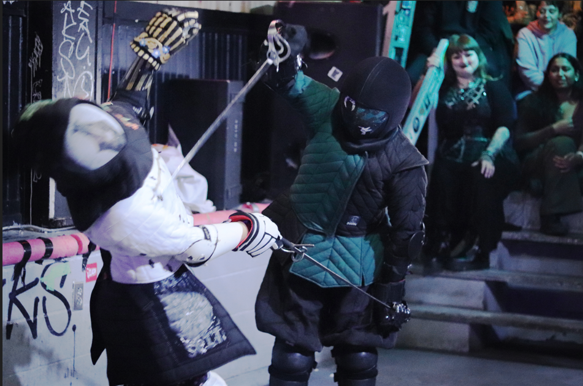
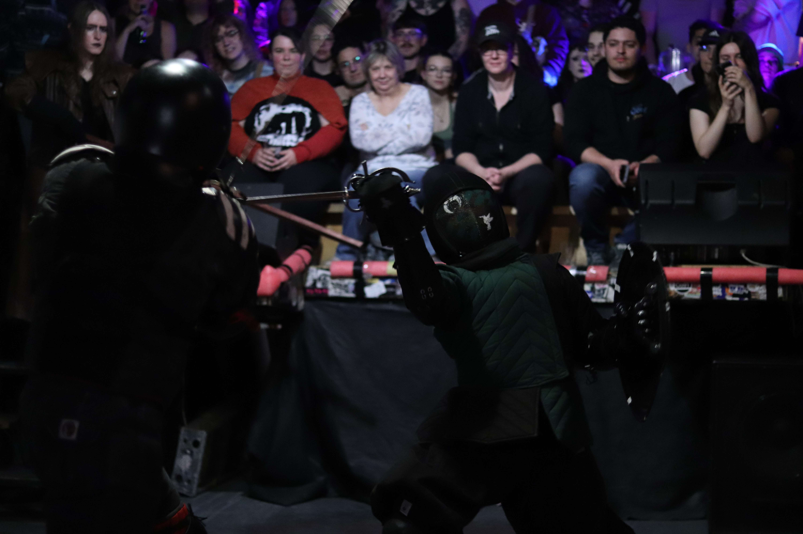
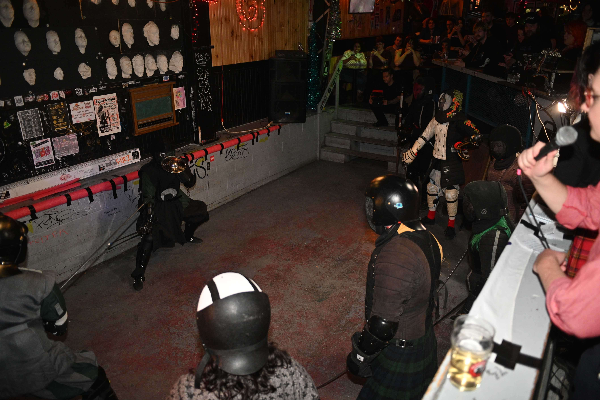
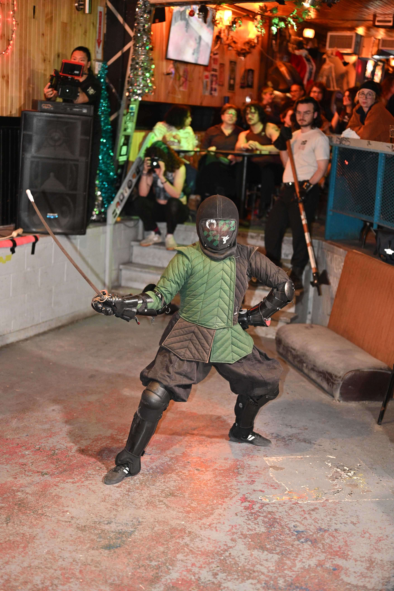

The Green Knight Fighting Perfect Primrose

The **Green Knight** is one of the earliest Fight Knight combatants, first appearing in [Fight Knight 1](/en/seasons/season-1).

A light-footed fighter, the Green Knight adheres to the philosophy that the best defensive tool should also be offensive - favouring a proactive and aggressive fighting style. The Green Knight is notable for their use of both one-handed swords and large shields.

The Green Knight has been crowned champion twice - first in [Fight Knight 6](/en/seasons/season-1#Fight-Knight-6), and again in [Fight Knight 17](/en/seasons/season-2#Fight-Knight-17).

# Fighting Style

Seeking to maintain pressure on their opponents, the Green Knight prefers entering with quick strikes while maintaining distance. When pressed, they leverage their speed and agility to get in close and grapple their opponents, often forcing them into a wall before breaking distance and resuming their strategy of striking from afar.

The Green Knight is prone to showboating, favouring deeply exaggerated stances and flourishes aimed at the crowd. They will refrain from hitting a disarmed opponent and may even return a lost weapon, but will become angered if the courtesy is not mutual. This has led to a grudge with [Sourpuss](/en/fighters/sourpuss) and a deep disliking for the [Dark Knight](/en/fighters/dark-knight).

# Lore

## The Hummingbird

During Fight Knight 13, the Green Knight fought alongside Sourpuss against the [Golden Hawk](/en/fighters/golden-hawk) and [Sir Huard](/en/fighters/sir-huard), but quickly agreed to betray Sourpuss in exchange for a handful of gold coins from Sir Huard.

As punishment for this betrayal, the Green Knight was stripped of their title and adopted "The Hummingbird" as their alias. They regained their title during Fight Knight 14 after suffering a [bear pit](/en/match-types#Bear-pit) at the hands of [The Highlander](/en/fighters/highlander), [The Golden Hawk](/en/fighters/golden-hawk), [The Valkyrie](/en/fighters/valkyrie), [Perfect Primrose](/en/fighters/perfect-primrose), [The Badger](/en/fighters/badger), and [The Dragon](/en/fighters/dragon).

# Trivia

|     |     |
| --- | --- |
| Pronouns | They/He |
| Alias(es) | The Hummingbird |
| First Appearance | Fight Knight 1 |
| Fighting Style(s) | Contre-Pointe |
| Preferred Weapons | Sabre; Shield |
| Notable Rival(s) | Sourpuss; The Dark Knight |

# Gallery

The Green Knight against The Badger

The Hummingbird in the Bear Pit

The Green Knight's signature stance